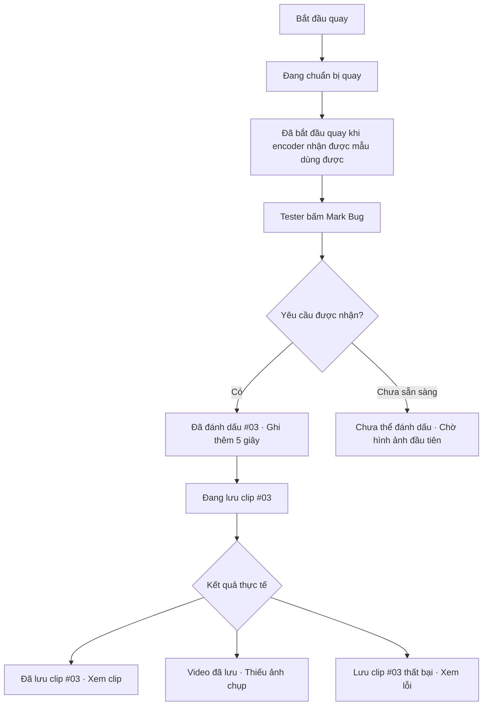

# 17 — Thiết kế phản hồi quay màn hình và Mark Bug

Ngày 21/11/2026. Trạng thái **luồng phản hồi chính đã triển khai vào spike 0.1.1-t010**, liên quan T-010, T-016, T-017, T-019, T-021 và T-022.

[Mở bản phác thảo tương tác](design/capture-feedback.html). Xem [bằng chứng triển khai Android](UI_UX_IMPLEMENTATION.md). Dữ liệu và thời gian xử lý trong bản phác thảo là mô phỏng.

## 1. Bối cảnh và mục tiêu

Tester đã xác nhận ghi được video từ APK `0.1.0-t010`. Phản hồi hiện tại chưa giúp họ biết lúc nào quay bắt đầu, thao tác Mark đã được nhận và clip đã lưu xong. Xác nhận này chưa đủ bằng chứng đóng toàn bộ V1–V9.

Đối chiếu mã tại commit `b9c16ec` cho thấy `SpikeOverlay` là huy hiệu BS 48 dp để thử quay overlay. Thao tác Mark hiện có trong app và thông báo. `SpikeUiState` có danh sách clip và số export, nhưng chưa thể hiện riêng từng marker trong giai đoạn ghi thêm. `AndroidClipMuxer` có thể trả thành công với đường dẫn ảnh rỗng. Các điểm này cần được nối vào luồng phản hồi khi triển khai.

| Câu hỏi thiết kế | Lựa chọn |
|---|---|
| Giai đoạn | App đã có capture spike, cần hoàn thiện trải nghiệm thử |
| Người dùng | QA thao tác một tay, phần lớn thời gian ở ứng dụng đang test |
| Công việc chính | Bắt đầu quay → đánh dấu lỗi → biết clip đã lưu → mở đúng clip |
| Ưu tiên thông tin | Trạng thái quay, kết quả thao tác, tiến trình marker, hành động tiếp theo |
| Thành công | Tester tự lưu và mở clip đầu tiên mà không cần đọc log hoặc hỏi vị trí file |
| Nền UI | Jetpack Compose + Material 3, palette navy/cyan hiện có |
| Rủi ro | Báo lưu quá sớm, báo nhầm marker, thông báo bị chặn, overlay che AUT |
| Kiểm chứng | Duyệt mô phỏng, sau đó test trên Ace 5 với chữ lớn, TalkBack và quyền bị từ chối |

## 2. Luồng chính



Trạng thái phiên và trạng thái marker độc lập. App vẫn có thể đang quay trong lúc một hoặc nhiều clip đang lưu. Mất quyền quay cũng có thể xảy ra khi những clip trước đó đang xuất.

## 3. Phản hồi theo sự kiện

| Sự kiện thực | Nội dung chính | Phản hồi và điều kiện |
|---|---|---|
| Đang xin quyền | Cho phép quay màn hình | Giải thích trong app trước hộp thoại hệ thống |
| Đã đồng ý, encoder đang chuẩn bị | Đang chuẩn bị quay… | Nút Mark tạm vô hiệu, có chỉ báo tiến trình |
| Đã nhận mẫu hợp lệ đầu tiên | Đã bắt đầu quay | Chip Đang quay và đồng hồ, lời nhắc ngoài app khoảng 3 giây |
| Buffer còn ngắn | Đã giữ 8 / 30 giây gần nhất | Vẫn cho Mark khi đã có keyframe, clip ngắn ghi thời lượng thực |
| Mark được chấp nhận | Đã đánh dấu #03 | Phản hồi thị giác mục tiêu ≤150 ms sau tap, rung xác nhận ngắn tại bề mặt đang thao tác |
| Đang nhận phần sau thao tác | Ghi thêm 5 giây cho #03 | Đếm ngược theo deadline monotonic của marker, giảm đến 0 |
| Đã đủ mẫu, chờ lượt xuất | Clip #03 đang chờ lưu | Tách hàng đợi khỏi giai đoạn ghi thêm |
| Bắt đầu mux/trích ảnh | Đang lưu clip #03… | Progress bất định, hiển thị số việc đang xử lý |
| File và trạng thái đã được chốt | Đã lưu clip #03 | Dấu hoàn thành + nút Xem clip, thời lượng và số ảnh thực |
| Video hợp lệ, ảnh thiếu | Video #03 đã lưu · Thiếu ảnh chụp | Màu cảnh báo, Xem clip vẫn dùng được, báo số ảnh thực |
| Hết lượt thử lại và xuất lỗi | Lưu clip #03 thất bại | Lý do ngắn + Xem lỗi, giữ marker và kết quả của các clip khác |
| Projection dừng | Quay đã dừng · Cần cấp lại quyền | Nút Cấp lại quyền quay, cập nhật ngay trên mọi bề mặt |

Chỉ phát “Đã lưu clip” sau khi file MP4 hợp lệ, rename hoàn tất và trạng thái đã được ghi vào nguồn dữ liệu của phiên. Với pipeline sản phẩm, commit DB phải thành công trước thông báo hoàn thành. Số ảnh trong thông báo lấy từ file đã xác minh. Tổng thời gian mục tiêu theo NFR-3 là post-roll + tối đa 5 giây xử lý.

Nếu nhận lệnh Mark nhưng chưa có keyframe, hiện “Chưa có hình để lưu. Chờ một chút rồi đánh dấu lại”. Phản hồi chấp nhận gắn với marker ID được tạo thành công. Trễ nhận yêu cầu hiện “Đang nhận thao tác…” đến khi có kết quả thực.

## 4. Bong bóng khi đang test app khác

### 4.1 Thao tác

- Chế độ mặc định theo spec 11 là bong bóng 56 dp, chạm để mở panel. Nhãn trợ năng “Mở điều khiển BugSnap, đang quay”.
- Panel rộng tối đa 280 dp, neo về phía trong màn hình. Nút chính Mark Bug cao ít nhất 56 dp, dưới là Mở BugSnap và Dừng quay. Dừng có xác nhận bằng nút hiển thị rõ. Note/Pause bổ sung ở các task sản phẩm tương ứng.
- Panel nhàn rỗi tự thu sau 3 giây. Khi TalkBack hoặc Switch Access đang điều khiển, panel giữ mở đến khi người dùng đóng.
- Tùy chọn **Mark nhanh** mặc định tắt theo spec 11. Khi bật, chạm bong bóng tạo marker ngay. Hành động Mở điều khiển được cung cấp qua nút tùy chọn riêng và accessibility action, người dùng luôn có đường bấm thay cho gesture.
- Sau một Mark hợp lệ, panel thao tác thu lại. Một thẻ trạng thái nhỏ hiện phía trong cạnh màn hình. Vùng Mark vẫn nhận lần đánh dấu kế tiếp.
- Kéo chỉ đổi vị trí. Phân biệt tap và drag bằng touch slop của Android. Lưu vị trí riêng theo hướng máy, có hành động “Đặt lại vị trí” trong panel.

### 4.2 Thẻ phản hồi

```text
Sau khi nhận Mark            Khi ghi thêm kết thúc       Khi lưu thành công
┌────────────────────────┐  ┌────────────────────────┐  ┌────────────────────────┐
│ Đã đánh dấu #03         │  │ Đang lưu clip #03…     │  │ Đã lưu clip #03         │
│ Ghi thêm 5 giây         │  │ 1 clip đang xử lý      │  │ 35 giây · 2 ảnh         │
└────────────────────────┘  └────────────────────────┘  │ [ Xem clip ]            │
                                                        └────────────────────────┘
```

Thẻ nhận thao tác và trạng thái hiện đủ 1,5 giây để đọc trong trường hợp post-roll = 0, đồng thời phản ánh bước thực đã tới. Thẻ hoàn thành hiển thị khoảng 4 giây. Thời gian có hành động được tăng theo cài đặt trợ năng của Android. Lỗi được giữ trong lịch sử và có đường mở lại từ bong bóng. Sau khi thẻ tự thu, panel luôn có “Clip vừa lưu” hoặc “Có clip lưu lỗi”.

Mỗi thẻ kèm số marker. Hiển thị thẻ mới nhất với tổng số clip đang xử lý. Lỗi còn tồn đọng có dòng riêng “1 clip lưu lỗi” cho đến khi người dùng xem. Kết quả marker cũ đến muộn cập nhật đúng marker và bộ đếm, tránh thay thẻ mới nhất bằng một thành công cũ.

Thẻ rộng tối đa 264 dp, co theo vùng khả dụng. Neo về trong cạnh, cách cutout, thanh hệ thống và vùng gesture. Overlay chỉ nhận chạm trong vùng nút và panel, kiểm tra chạm AUT ở xung quanh trên thiết bị thật. Chữ lớn có thể mở thẻ cao hơn. Landscape dùng bố cục gọn và cuộn panel nếu cần.

Toàn màn hình có thể quay cả overlay và thẻ phản hồi. Cần xác minh lại V2/V3 với thiết kế này và ghi rõ điều đó trong phần trợ giúp. Dùng hiển thị ngắn, nội dung tối thiểu để giảm che bằng chứng.

## 5. Thông báo khi app ở nền

| Loại | Nội dung đề xuất | Hành động |
|---|---|---|
| Đang quay, chưa có marker | BugSnap đang quay · Đã giữ 30 giây gần nhất | Mark Bug, Dừng |
| Đang ghi thêm | Đã đánh dấu #03 · Ghi thêm 4 giây | Mark Bug, Dừng |
| Đang xuất | Đang lưu 2 clip · Đã lưu 3 clip | Mark Bug, Mở BugSnap |
| Kết quả | Đã lưu clip #03 · 35 giây · 2 ảnh | Xem clip, Mở BugSnap |
| Lỗi | Clip #03 lưu thất bại · Bộ nhớ đầy | Xem lỗi, Mở BugSnap |
| Mất projection | Quay đã dừng · Cần cấp lại quyền | Mở BugSnap |

Giữ thông báo điều khiển phiên và một thông báo kết quả tổng hợp. Kết quả cập nhật theo ID, gộp burst thành “Đã lưu 3 clip”, chạm mở danh sách kết quả. Thông báo đơn mở đúng clip qua marker ID. Nội dung trên màn hình khóa dùng bản công khai “BugSnap · Có cập nhật về clip”, chi tiết khi mở khóa.

Kênh điều khiển và kênh kết quả đề xuất `LOW`, thông báo lặng. Thẻ overlay là phản hồi trực tiếp khi có quyền. Khi thiếu overlay, người dùng có thể kéo khay thông báo để đọc kết quả. Việc hiện banner nổi của hệ thống phụ thuộc mức quan trọng của kênh và cài đặt của người dùng. Thiết kế không dựa vào giả định banner luôn xuất hiện. Android 13+ cho phép người dùng từ chối thông báo, khi đó app cần phản ánh trong màn quyền. [Quyền thông báo](https://developer.android.com/develop/ui/compose/notifications/notification-permission), [Thiết kế kênh thông báo](https://developer.android.com/design/ui/mobile/guides/home-screen/notifications)

Nếu cả overlay và thông báo đều bị chặn, hiện trong app “Điều khiển trên màn hình BugSnap. Bật thông báo hoặc bong bóng để đánh dấu khi dùng app khác” với nút mở cài đặt. Không tự yêu cầu nhiều quyền cùng lúc. QS tile là khả năng T-020, cần đánh dấu mức hỗ trợ thực của bản APK khi triển khai.

## 6. Màn hình trong BugSnap

### 6.1 Chuẩn bị

App bar BugSnap AI và Trợ giúp. Phần chính có “Sẵn sàng quay thử”, mô tả “Giữ tối đa 30 giây gần nhất. Bấm Mark Bug khi gặp lỗi để lưu clip”, cấu hình 30 giây trước / 5 giây sau và trạng thái quyền có hành động trực tiếp.

Nút chính ở đáy vùng an toàn **Bắt đầu quay**. Xin quyền theo từng bước. Người dùng chọn một app hoặc toàn màn hình bằng hộp thoại Android. Từ chối quay trả về màn chuẩn bị với lời giải thích và nút thử lại.

### 6.2 Đang quay

App bar, chip “Đang quay”, đồng hồ `mm:ss`, “Đã giữ 30 / 30 giây gần nhất”. Phần chỉ dẫn “Chuyển sang app cần test. Khi gặp lỗi, dùng Mark Bug trên bong bóng hoặc trong thông báo”.

Nút chính **Mark Bug** ở nửa dưới màn hình. Dừng quay là hành động phụ. Mục **Clip của phiên** hiện ngay bên dưới trạng thái, gồm marker ID, thời điểm, trạng thái và nút mở. RAM/FPS/keyframe/V1/V7 nằm trong **Kiểm thử kỹ thuật** có thể mở rộng.

### 6.3 Sau khi lưu

Thẻ mới nhất “Đã lưu clip #03”, `35 giây · 2 ảnh`, nút **Xem clip**. Dòng phụ “Lưu trong BugSnap · Clip của phiên”. Xem clip là thao tác chủ động, phiên quay tiếp tục theo trạng thái thực. Khi trở về từ trình phát, giữ lại danh sách, vị trí cuộn và trạng thái phiên.

Danh sách hiển thị cả marker đang ghi thêm, chờ lưu, lưu lỗi và đã lưu. Sau Dừng, hiện “Đang hoàn tất 2 clip” cho tới kết quả cuối cùng rồi “Đã dừng · Đã lưu 3 clip · 1 clip lỗi”. Thao tác Dừng lúc post-roll đang chạy chốt phần hiện có, ghi “Clip ngắn hơn do dừng quay”.

Spike đang giữ danh sách trong bộ nhớ tiến trình. Khả năng xem lại sau đóng app cần nối metadata bền vững qua T-014/T-016/T-022. Khi triển khai sớm vào spike, phải có index clip cục bộ hoặc đọc lại metadata đã lưu, nghiệm thu mở lại app vẫn thấy clip đã hoàn tất.

## 7. Nhiều marker và các đường phục hồi

| Tình huống | Hành vi thiết kế |
|---|---|
| Bấm liên tiếp hợp lệ | Mỗi thao tác được nhận có ID riêng. Ví dụ “Đã đánh dấu #04 · 3 clip đang xử lý”. Tối đa 3 export song song theo T-016 |
| Bấm trùng trong 300 ms | Debounce theo spec 07, giữ phản hồi lần trước, số marker tăng đúng số lệnh đã nhận |
| File lỗi, còn snapshot | Pipeline tự thử lại tối đa 1 lần, hiện “Đang thử lưu lại #03” |
| Hết lượt retry | Hiện lỗi cuối. Chỉ có nút Thử lưu lại khi dữ liệu nguồn còn thực sự dùng được và task triển khai hỗ trợ |
| Bộ nhớ đầy | “Bộ nhớ đầy. Giải phóng dung lượng để quay tiếp”, nút Mở BugSnap để xử lý và trạng thái pause theo spec |
| Mất quyền lúc đang ghi thêm | Flush dữ liệu có sẵn. Hiện cả “Quay đã dừng” và tiến trình hoàn tất clip; kết quả có thời lượng thực |
| Process bị kill | Khi mở lại, phiên FAILED và marker chưa hoàn tất thành CLIP_LOST theo T-015. Clip hoàn tất đọc lại từ lưu trữ |
| Mở file thất bại | “Không mở được clip #03”, hiển thị nguyên nhân phù hợp và quay về danh sách, giữ metadata |
| Một ảnh không trích được | “Video đã lưu · 1/2 ảnh”, hiển thị video có thể mở và chi tiết ảnh thiếu |

Đề xuất rung nhẹ khi Mark được chấp nhận tại bề mặt trực tiếp, tôn trọng thiết lập hệ thống. Thành công sau xử lý dùng phản hồi thị giác, thông báo lặng và kết quả bền vững. Lỗi tại thao tác trực tiếp có thể dùng haptic loại từ chối, tôn trọng cài đặt của người dùng. [Haptic feedback Android](https://developer.android.com/develop/ui/views/haptics/haptic-feedback)

## 8. Ngôn ngữ thị giác và trợ năng

| Thành phần | Quy cách đề xuất |
|---|---|
| Theme | Dark-first theo spec 11, nền #0B1220, surface #111B2E, cyan #22D3EE |
| Văn bản | Chính #E6EDF7, phụ #93A4BD, body 16 sp, label tối thiểu 14 sp cho thao tác |
| Trạng thái | Cyan + biểu tượng quay, amber + tiến trình/cảnh báo, xanh + dấu hoàn thành, đỏ + biểu tượng lỗi |
| Icon | Vector Material Symbols nhất quán, 24 dp, icon trang trí cạnh nhãn loại khỏi cây trợ năng |
| Khoảng cách | Thang 4/8 dp, lề màn 16–24 dp, khoảng giữa mục 16–24 dp |
| Vùng chạm | Ít nhất 48 × 48 dp, nút chính cao 56 dp, khoảng cách giữa nút ít nhất 8 dp |
| Hình dạng | Nút pill theo M3, thẻ 16 dp, panel 20 dp |
| Chuyển động | Ripple ngay khi chạm, chuyển trạng thái khoảng 150–200 ms. Khi giảm chuyển động, cập nhật chữ và icon trực tiếp |
| Cỡ chữ | Co theo màn và fontScale, nội dung xuống dòng. Panel cuộn khi chiều cao khả dụng ngắn |

Đề xuất sử dụng theme navy/cyan đã có. Nếu bổ sung light theme hoặc dynamic color sau này, cần đo lại từng cặp màu và màu semantic cho trạng thái trước khi dùng.

TalkBack đọc một lần theo mốc “Đã đánh dấu lỗi số 3”, “Đang lưu clip số 3”, “Đã lưu clip số 3”. Countdown giữ trong stateDescription khi focus, tránh phát live announcement mỗi giây. Gắn nhãn rõ nút mở clip và bong bóng. Tôn trọng focus hiện có khi có kết quả mới. Các sự kiện quan trọng dùng live region polite hoặc cơ chế tương đương trong View overlay. [Semantics trong Compose](https://developer.android.com/develop/ui/compose/accessibility/semantics)

## 9. Hợp đồng trạng thái để triển khai

Đề xuất thêm trạng thái trình bày per marker `Accepted`, `CollectingPostRoll(deadline)`, `Queued`, `Exporting`, `Saved`, `SavedWithWarning`, `Failed`, `Lost`. Các trạng thái này ánh xạ về status DB hiện có, không thêm enum DB chỉ để phục vụ animation.

Mỗi sự kiện có session ID, marker ID, thứ tự sự kiện, thời điểm monotonic và số ảnh/thời lượng thực khi hoàn tất. StateFlow là nguồn cho cả Compose, overlay và thông báo. Sự kiện UI tiêu thụ một lần như rung/announcement có ID để tránh phát lại khi xoay màn hình. Kết quả lưu bền vững phục vụ mở lại app và notification intent.

Các số đếm `pendingCount`, `exportingCount`, `savedCount`, `failedCount` lấy từ cùng danh sách marker. Đếm ngược tính từ deadline, không dựa vào số lần UI tick. Tiến trình xuất file dùng bất định đến khi có tín hiệu đo được. Animation là cách trình bày trạng thái thực.

## 10. Phạm vi triển khai tiếp theo

1. Bổ sung phản hồi T-010 theo state per marker, nối cả Mark trong app và notification. Nghiệm thu nhận thao tác → ghi thêm → lưu/ lỗi, kèm danh sách clip có thể đọc lại.
2. Nối điều khiển nổi và thẻ phản hồi vào T-019. Mặc định chạm mở panel, chế độ Mark nhanh do người dùng bật. Thử thật vị trí, gesture và ảnh hưởng lên clip.
3. Dùng cùng hợp đồng trạng thái trong T-016/T-017/T-021/T-022 khi chuyển sang pipeline sản phẩm. Mỗi lần thực hiện một task theo AGENTS.

## 11. Tiêu chí nghiệm thu thiết kế và triển khai

- Mở prototype và tự đi từ Bắt đầu → Mark Bug → Xem clip mô phỏng. Trạng thái đơn, nhiều marker và lỗi có thể chọn lại để xem.
- Trên APK triển khai, phản hồi tap mục tiêu ≤150 ms và luôn xác định được marker vừa nhận.
- Ghi thêm mặc định 5 giây, sau đó “Đang lưu”, kết quả bám sự kiện thực. Post-roll 0/3/10 giây cũng có phản hồi đọc được.
- Mười marker trong 3 giây khi nguồn gọi hợp lệ vẫn có đủ ID và kết quả đúng, lỗi của một marker không che mất kết quả khác.
- Xem clip từ overlay/notification mở đúng marker, tiếp tục ghi theo trạng thái phiên và có đường trở về app.
- Thử thiếu overlay, thiếu thông báo, cả hai bị chặn, haptic tắt, DND, khóa máy, hết dung lượng, ảnh thiếu, xoay ×20 và process kill.
- Màn 360 dp, điện thoại lớn, tablet và landscape sử dụng được với fontScale tối đa và TalkBack. Vùng chạm đáp ứng 48 dp và không che gesture.
- Thử V2/V3 trên Ace 5 để biết thẻ phản hồi có vào clip và che nội dung tới mức nào.
- Kết quả thử trên thiết bị phải có build/OS/ngày, riêng từng tiêu chí. Ghi được video là bằng chứng ban đầu cho capture.

## 12. Kết quả kiểm tra bản thiết kế

Các con số, danh sách clip và video trong HTML là dữ liệu mô phỏng để duyệt hành vi. Rung, overlay thật, notification Android và MediaProjection cần kiểm chứng ở APK triển khai. Bản vẽ thông báo chỉ thể hiện thứ tự nội dung và hành động, diện mạo cuối do Android/OxygenOS quyết định.

Đã kiểm tra cú pháp JavaScript và luồng trạng thái bằng Node với DOM giả lập, gồm bắt đầu, nhận Mark, countdown, debounce, nhiều marker, xuất thành công, lỗi, thiếu overlay và mất projection. Đã kiểm tra ID HTML, đường dẫn tài liệu và 18 cặp màu chữ/trạng thái trên ba nền tối đạt tương phản tối thiểu 4,5:1. `git diff --check` đạt.

Prototype giữ thẻ kết quả mở để đọc và giữ các tình huống chọn sẵn đứng yên để duyệt. Thời gian tự thu, rung và vị trí tương tác thực tuân theo các mục 4, 7 và 8 khi triển khai Android. Công cụ xem trước trình duyệt không kết nối được trong phiên này, nên kiểm tra bằng ảnh render, màn nhỏ, landscape, fontScale và TalkBack vẫn cần thực hiện trên bản triển khai.

Bản Android 0.1.1-t010 đã được build, kiểm thử và chụp trên emulator Android 16. Ảnh giao diện, phạm vi kiểm chứng và kết quả xem tại [nhật ký triển khai](UI_UX_IMPLEMENTATION.md).
