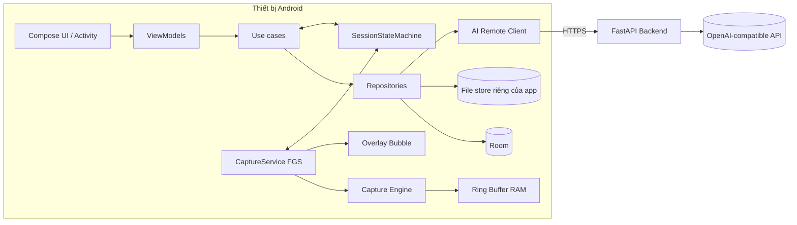
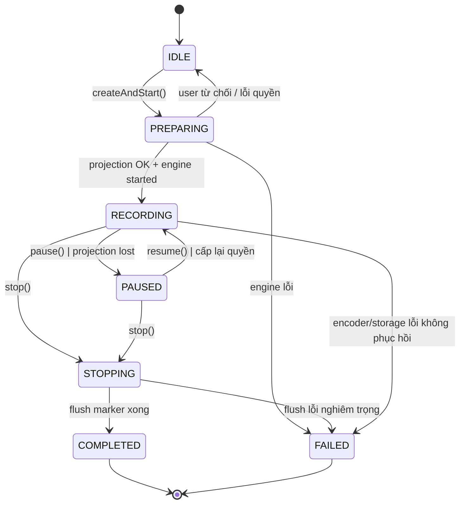
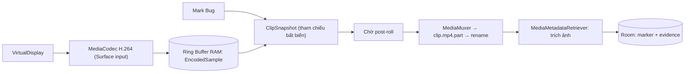

# 05 — Kiến trúc Android

## 1. Nguyên tắc
- **Một module `:app` cho MVP**, tổ chức theo package-by-feature và ranh giới lớp rõ ràng. Tách module Gradle chỉ khi: build > 2 phút do kích thước, hoặc có nhóm làm song song, hoặc cần tái dùng `capture` ở app khác. Khi tách, thứ tự: `:core-capture` → `:data` → `:feature-*`.
- MVVM + UDF (UiState/Event), Clean Architecture **nhẹ**: có `domain` (use case, model, interface repo) chỉ cho phần có logic thật (session, marker, report); CRUD đơn giản dùng thẳng repository.
- Stack: Kotlin, Compose + Material 3, Coroutines/Flow, Room, DataStore, Hilt, WorkManager (chỉ cho hàng đợi gửi AI), Retrofit/OkHttp hoặc Ktor client (chọn một, ghi ADR), kotlinx.serialization.
- `minSdk 29` (MediaProjection cần FGS type từ Android 10), `targetSdk 36`, `compileSdk 37`. Thiết bị chính: Android 16. `compileSdk` được nâng lên 37 khi khởi tạo T-001 vì Compose 1.12+ (BOM 2026.09.00) yêu cầu compileSdk 37; `targetSdk` giữ 36 (xem ADR-12).

## 2. Kiến trúc hệ thống


## 3. Cấu trúc package (`com.bugsnap.ai`)
```text
core/        common (Result, DomainError, Clock, Dispatchers), di, permission, notification
domain/      model, repository (interface), usecase
data/        db (Room), files (EvidenceStore), remote (AiApi), repo (impl), settings (DataStore)
capture/     engine (ProjectionHolder, VirtualDisplayController, EncoderPipeline),
             buffer (EncodedSample, RingBuffer, ClipSnapshot), export (ClipMuxer, FrameExtractor)
session/     SessionStateMachine, SessionCoordinator, CaptureService, ServiceBinder
overlay/     BubbleController, BubbleView(Compose/Views), BubbleState, QuickActionTile
ui/          home, newsession, activesession, marker, reportreview, history, library, settings, theme, navigation
```
Quy tắc phụ thuộc: `ui → domain ← data`; `session/capture/overlay` phụ thuộc `domain` qua interface; `capture` **không** biết Room/UI.

## 4. Thành phần chính và trách nhiệm
| Thành phần | Trách nhiệm | Không được làm |
|---|---|---|
| `SessionCoordinator` | Nguồn sự thật duy nhất của trạng thái phiên (StateFlow); nhận lệnh từ UI, bubble, notification | Chạm vào MediaCodec |
| `SessionStateMachine` | Bảng chuyển trạng thái thuần Kotlin, test được | Giữ tài nguyên Android |
| `CaptureService` | Foreground service, giữ vòng đời projection, hiện bubble, notification | Chứa logic nghiệp vụ marker |
| `CaptureEngine` | VirtualDisplay + encoder, đẩy sample vào RingBuffer, xử lý xoay/resize | Ghi DB |
| `MarkerPipeline` | Mark → snapshot → chờ post-roll → mux → trích ảnh → ghi DB | Quản lý UI |
| `EvidenceStore` | Đường dẫn file, ghi `.part`+rename, dọn rác, xóa theo phiên | Biết về AI |
| `ReportGenerator` (use case) | Dựng payload đã duyệt, gọi API, validate, lưu | Tự gửi khi chưa duyệt |
| `BubbleController` | Cửa sổ overlay, kéo thả, trạng thái thu/mở | Giữ state phiên riêng |

## 5. Session state machine

- `PAUSED` có `pauseReason`: `USER`, `PROJECTION_LOST`, `LOW_STORAGE`, `SCREEN_LOCKED`.
- Mark Bug chỉ hợp lệ ở `RECORDING`. Mọi chuyển không có trong bảng ⇒ `IllegalTransition` (log + bỏ qua, không crash).
- `FAILED` vẫn giữ marker/bằng chứng đã có; người dùng xem lại được.
- Khởi động app: phiên ở `RECORDING/PAUSED/PREPARING/STOPPING` trong DB mà không có service sống ⇒ chuyển `FAILED(reason=PROCESS_DIED)`, marker `PENDING` ⇒ `CLIP_LOST`.

## 6. Luồng dữ liệu capture → bằng chứng


## 7. Interface repository (rút gọn)
```kotlin
interface SessionRepository {
    fun observe(id: String): Flow<Session?>
    fun observeAll(): Flow<List<Session>>
    suspend fun create(draft: NewSession): Result<Session>
    suspend fun updateState(id: String, state: SessionState, reason: PauseReason?): Result<Unit>
    suspend fun delete(id: String): Result<Unit>        // xóa DB + file
}
interface MarkerRepository {
    fun observeBySession(sessionId: String): Flow<List<BugMarker>>
    suspend fun insertPending(marker: NewMarker): Result<BugMarker>
    suspend fun attachEvidence(markerId: String, evidence: List<Evidence>): Result<Unit>
    suspend fun updateNote(markerId: String, note: String): Result<Unit>
    suspend fun markClipStatus(markerId: String, status: ClipStatus): Result<Unit>
}
interface ReportRepository {
    fun observeAll(filter: ReportFilter): Flow<List<BugReportSummary>>
    suspend fun saveDraft(report: BugReport): Result<Unit>
    suspend fun complete(reportId: String): Result<Unit>
    suspend fun search(query: String): List<BugReportSummary>
}
interface AiReportClient {
    suspend fun generate(payload: ApprovedPayload): Result<GeneratedReport>   // chỉ nhận payload đã duyệt
}
```
(Đây là hợp đồng để agent tham chiếu, không phải code triển khai.)

## 8. Chiến lược lỗi
`DomainError` (sealed): `PermissionDenied`, `ProjectionLost`, `EncoderFailure`, `StorageLow`, `ClipExportFailed`, `NetworkUnavailable`, `AiTimeout`, `AiSchemaInvalid`, `Unauthorized`, `Unknown(cause)`. Mọi tầng trả `Result<T, DomainError>`; UI ánh xạ thành thông điệp tiếng Việt có hành động tiếp theo (thử lại / cấp quyền / soạn tay).

## 9. Quản lý quyền
| Quyền | Khi nào xin | Nếu từ chối |
|---|---|---|
| `POST_NOTIFICATIONS` (13+) | Onboarding | Vẫn chạy FGS nhưng thông báo có thể ẩn; cảnh báo người dùng |
| `SYSTEM_ALERT_WINDOW` | Onboarding/trước phiên đầu | Chế độ dự phòng (notification action + QS tile) |
| MediaProjection | **Mỗi phiên** | Phiên không bắt đầu (`PREPARING → IDLE`) |
| `RECORD_AUDIO` | V2, chỉ khi dùng ghi chú giọng nói | Ghi chú giọng nói tắt |
| Bỏ tối ưu pin | Hướng dẫn tùy chọn | Cảnh báo rủi ro bị kill |
| Usage access | Không dùng ở MVP | — |
`PermissionCoordinator` gom trạng thái quyền thành một `StateFlow<PermissionState>` để UI hiển thị trạng thái "Permission states".

## 10. Thực thi nền
- `CaptureService`: FGS type `mediaProjection`, `START_NOT_STICKY` (không tự khởi động lại vì token một lần), notification liên tục có nút Mark Bug / Pause / Stop.
- Chỉ start từ Activity đang hiển thị (tránh hạn chế FGS từ nền).
- Không dùng WorkManager cho capture. WorkManager chỉ để gửi AI khi có mạng.
- Xử lý `onTimeout`/`onDestroy`: flush marker pending, release tài nguyên, cập nhật state.
