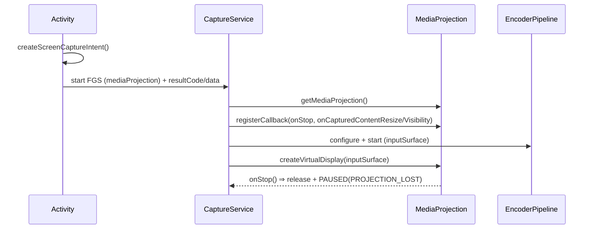

# 06 — Screen Capture Engine

## 1. Thành phần bắt buộc và lý do
| API | Cần? | Lý do |
|---|---|---|
| `MediaProjection` (+`MediaProjectionManager`) | **Có** | Nguồn quay màn hình hợp lệ duy nhất không cần root |
| `VirtualDisplay` | **Có** | Cầu nối projection → Surface |
| `MediaCodec` (H.264, Surface input) | **Có** | Nén video; nền tảng của ring buffer |
| `MediaMuxer` (MP4) | **Có** | Ghi clip khi Mark Bug |
| Foreground Service (`mediaProjection`) | **Có** | Bắt buộc để chạy projection |
| `ImageReader` | **Không (MVP)** | Chỉ một VirtualDisplay mỗi token; chạy song song với encoder cần GL. Ảnh chụp trích từ clip |
| `MediaRecorder` | Không | Không cho truy cập mẫu đã mã hóa để làm ring buffer |
| `MediaMetadataRetriever` | **Có** | Trích khung hình từ clip |

## 2. Vòng đời projection (đã đối chiếu tài liệu)
1. Activity gọi `createScreenCaptureIntent()` → người dùng đồng ý (trên 14+: có thể chọn toàn màn hình hoặc một app).
2. Trong `onActivityResult`/launcher: **start FGS type `mediaProjection`** rồi mới gọi `getMediaProjection(resultCode, data)`.
3. **Đăng ký `MediaProjection.Callback` trước khi** `createVirtualDisplay`. `onStop()` ⇒ giải phóng VirtualDisplay/Surface/encoder.
4. Projection có thể dừng do: người dùng dừng ở UI hệ thống, **khóa màn hình**, phiên projection khác bắt đầu.
5. Token một lần: sau khi dừng phải xin lại.

## 3. Thông số encode mặc định (cấu hình được)
| Tham số | Mặc định | Ghi chú |
|---|---|---|
| Codec | `video/avc` (H.264) | Tương thích rộng, mux MP4 ổn định |
| Cạnh dài | 1280 px (giữ tỉ lệ, làm tròn bội 16) | Giảm tải nhiệt/pin; đủ đọc UI |
| FPS | 30 (hoặc 24 nếu nóng máy) | Màn hình tĩnh tạo ít frame (VFR) |
| Bitrate | 4 Mbps (CBR/VBR theo hỗ trợ) | 30 s ≈ 15 MB (dữ liệu pre-roll đã mã hóa; clip còn cộng post-roll) |
| Khoảng I-frame | 1 s | Điểm cắt clip chính xác ≤ 1 s |
| Màn hình tĩnh | `repeat-previous-frame-after` ≈ 1 s hoặc `PARAMETER_KEY_REQUEST_SYNC_FRAME` định kỳ | Đảm bảo luôn có keyframe để cắt clip **[cần xác minh trên Ace 5]** |
| Âm thanh | Không (MVP) | Quay audio nội bộ bị hạn chế; ghi chú giọng nói tách riêng (V2) |

## 4. Xoay màn hình / đổi độ phân giải
- Đăng ký theo dõi cấu hình; khi kích thước/hướng đổi: tạo **encoder generation mới** với kích thước mới, `VirtualDisplay.setSurface()` sang Surface mới, `resize()` nếu cần.
- Một file MP4 không đổi kích thước giữa chừng ⇒ **clip chỉ gồm mẫu của generation hiện tại** ở thời điểm Mark Bug. Hệ quả: nếu xoay máy trong 30 s trước bug, clip ngắn hơn. Ghi rõ trong UI ("Clip bắt đầu từ lần xoay màn hình gần nhất").
- T-012: detach Surface trước khi đóng encoder cũ; không tạo thêm VirtualDisplay. Đổi profile kết thúc pending bằng dữ liệu đã ghi và chờ keyframe generation mới trước khi cho Mark. Chặn cả callback generation cũ đang đến trong lúc resize, không chỉ callback sau khi encoder cũ đã đóng.
- Phương án thay thế (V2, nếu cần): giữ canvas cố định và letterbox qua GL — phức tạp, không làm ở MVP.

## 5. Ảnh chụp khi Mark Bug
1. Sau khi mux clip: `MediaMetadataRetriever.getFrameAtTime(tMark, OPTION_CLOSEST)` → `screenshot_mark.jpg`.
2. Thêm một ảnh ở `tMark − 2 s` (`screenshot_pre.jpg`) để giúp AI/tester thấy trạng thái trước lỗi.
3. Chất lượng JPEG 85, kích thước = kích thước encode (1280 cạnh dài). Ảnh này **có thể gồm bong bóng** nếu quay toàn màn hình.
- Nhược điểm chấp nhận: ảnh có độ phân giải bằng video, trễ ≈ post-roll. Ưu điểm: không GL, một nguồn sự thật.

## 6. Bong bóng và nội dung quay
- Quay toàn màn hình ⇒ bong bóng **có thể xuất hiện** trong video. Không có API công khai đáng tin để loại trừ **[cần xác minh]**.
- Nếu tester chọn **chia sẻ một ứng dụng (AUT)** ở hộp thoại hệ thống, kỳ vọng chỉ cửa sổ app được quay, bong bóng không vào video **[cần xác minh trên OxygenOS 16; xử lý khi AUT ra nền]**. Khuyến nghị thử nghiệm trong spike `T-010`.
- Giảm che khuất: bong bóng 44–48 dp, alpha 0.6 khi nhàn rỗi, bám cạnh, panel mở rộng nhỏ và tự thu sau 3 s.

## 7. Tài nguyên, pin, nhiệt
- Encode phần cứng (`MediaCodec` HW). Đặt `KEY_PRIORITY`/`KEY_OPERATING_RATE` mặc định, không ép.
- Giảm tải tự động: nếu `PowerManager.currentThermalStatus ≥ MODERATE` ⇒ hạ xuống 24 fps/3 Mbps; ≥ SEVERE ⇒ thông báo và đề nghị Pause.
- Kiểm soát RAM: xem `07`. Kiểm soát dung lượng: chỉ ghi đĩa khi Mark Bug.
- Khi pin < 15% và không sạc: cảnh báo, gợi ý giảm buffer.

### 7.1. Cấu trúc T-012
- `capture/engine/CaptureEngine`: state/command, ring buffer, khóa điều khiển, generation và thermal policy. Backend port cho unit test; không chạm DB/file/UI.
- `AndroidCaptureBackend`, `ProjectionHolder`, `VirtualDisplayController`, `EncoderPipeline`: một worker looper cho thao tác codec/display, polling output và release. Callback projection được đăng ký trước createVirtualDisplay. FGS vẫn do Service bật trước khi gọi engine. Bản 0.1.3 đổi async codec sang polling và Baseline theo [báo cáo video đen](../../../T012_BLACK_VIDEO_FIX.md).
- `CaptureEngineFactory` qua Hilt tạo engine mới mỗi consent. Parent scope bị hủy vẫn lên lịch cleanup trên worker trước khi quit; close/pause/resize lỗi vẫn giải phóng các handle khác. Lỗi cleanup được giữ riêng trong state và log.
- `CaptureResourceTracker` đếm handle đang sở hữu, peak và lỗi release; kết hợp kiểm tra MP4 và đo PSS/native heap. Số handle về 0 không tự chứng minh driver OEM không rò bộ nhớ.
- API pause/resume giữ cùng projection/display, tạo encoder generation mới. UI pause sản phẩm thuộc các task coordinator/service sau; T-012 không tự phục hồi projection đã mất.
- Đồng bộ worker và thermal policy đã được cài đặt; trạng thái kiểm thử/những phần chưa nghiệm thu ghi tại [T012_CAPTURE_ENGINE.md](../../../T012_CAPTURE_ENGINE.md).

## 8. Giới hạn đã biết
- `FLAG_SECURE`: vùng đó đen trong clip. **Không bao giờ** tìm cách vượt qua.
- DRM video (Netflix…): đen. Bình thường.
- Khóa màn hình dừng projection ⇒ phải xin lại.
- Cuộc gọi/ứng dụng ghi màn hình khác có thể làm projection dừng.

## 9. Cần xác minh trên thiết bị (checklist cho spike T-010)
| # | Câu hỏi | Cách kiểm tra |
|---|---|---|
| V1 | Token dùng lại có lỗi `SecurityException` ở Android 16? | Thử tạo VirtualDisplay lần hai |
| V2 | Chọn "một app" thì overlay có vào video không? AUT ra nền thì sao? | Quay thử, xem clip |
| V3 | Quay toàn màn hình: bong bóng có hiện trong clip? | Như trên |
| V4 | Màn hình tĩnh có sinh keyframe định kỳ với tham số đã chọn? | Dump `BUFFER_FLAG_KEY_FRAME` |
| V5 | Khóa màn hình có gọi `onStop`? Mở khóa có tự phục hồi? | Thử thủ công |
| V6 | OxygenOS có kill service sau bao lâu khi tắt màn hình/pin yếu? | Chạy 60 phút, theo dõi |
| V7 | Android 15+ ẩn nội dung thông báo trong clip? | Gửi thông báo thử |
| V8 | Độ trễ Mark → clip xong; RAM thực tế | Profiler |
| V9 | Xoay màn hình: `setSurface` + encoder mới hoạt động không rò rỉ? | Xoay 20 lần |
Kết quả điền vào `docs/16` mục "Kết quả spike".
