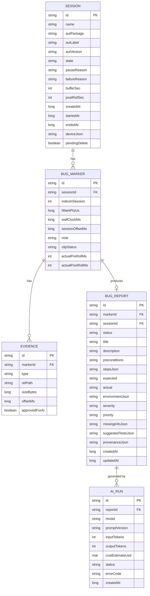

# 09 — Thiết kế cơ sở dữ liệu và lưu trữ

## 1. Công nghệ
- **Room (SQLite)** cho dữ liệu quan hệ + **FTS4** cho tìm kiếm thư viện bug.
- **DataStore (Preferences)** cho cài đặt (độ dài buffer 15/30 s, mặc định 30; post-roll, URL backend, trần ngân sách).
- **File store riêng của app** cho ảnh, index, dữ liệu phiên và video tạm. Theo yêu cầu chủ dự án sau T-014, **video mới của spike lưu công khai trong `DCIM/BugSnap` qua MediaStore**. Clip cũ vẫn ở khu vực riêng và mở qua FileProvider. Xem [DCIM_VIDEO_STORAGE.md](../../../DCIM_VIDEO_STORAGE.md).
- Token backend: lưu bằng Android Keystore (EncryptedFile/ `Tink`, ghi ADR khi chọn), không để trong DataStore thô.

## 2. Sơ đồ quan hệ


## 3. Giá trị enum
- `session.state`: IDLE, PREPARING, RECORDING, PAUSED, STOPPING, COMPLETED, FAILED.
- `pauseReason` (chỉ khi `PAUSED`): USER, PROJECTION_LOST, LOW_STORAGE, SCREEN_LOCKED.
- `failureReason` (chỉ khi `FAILED`): PROCESS_DIED, ENGINE, FLUSH, ENCODER, STORAGE. (`PROCESS_DIED` không thuộc `pauseReason`; `05` là nguồn sự thật.)
- `marker.clipStatus`: PENDING, READY, CLIP_FAILED, CLIP_LOST.
- `evidence.type`: CLIP, SCREENSHOT_MARK, SCREENSHOT_PRE, KEYFRAME, VOICE, ANNOTATED (V2).
- `report.status`: DRAFT (soạn tay), AI_QUEUED, AI_GENERATED (chờ duyệt), NEEDS_REVIEW (còn trường cần xác nhận), COMPLETED.
- `provenanceJson`: bản đồ `field → {source, confidence, needsConfirmation}` để UI tô nổi trường cần xác nhận. COMPLETED chỉ khi mọi `needsConfirmation` đã được tester xác nhận hoặc sửa.

## 4. Ràng buộc và chỉ mục
- Khóa ngoại bật `ON DELETE CASCADE` (xóa phiên xóa marker/evidence/report DB) — **file xóa riêng** bởi `EvidenceStore.deleteSession()` trong cùng use case; thứ tự: xóa file → xóa DB; nếu xóa file lỗi, đặt `session.pendingDelete = true` (cờ boolean, **không** phải `session.state`) và giữ bản ghi (kèm state `COMPLETED`/`FAILED`) để thử lại.
- Chỉ mục: `bug_marker(sessionId, indexInSession)` unique; `evidence(markerId)`; `bug_report(status, updatedAt)`; `bug_report(sessionId)`.
- `bufferSec` chỉ nhận 15 hoặc 30; mặc định 30. Không lưu/không cho chọn 60.
- `relPath` lưu **đường dẫn tương đối** so với gốc file store (an toàn khi di chuyển/backup).
- Thời gian lưu epoch millis UTC.

## 5. Tìm kiếm (FTS)
Bảng ảo `bug_report_fts(title, description, stepsText, note)` (Room `@Fts4`, content-sync với `bug_report`). Lọc: trạng thái, phiên, severity, khoảng ngày; sắp xếp `updatedAt desc`.

## 6. Bố cục file
```text
files/
└── sessions/{sessionId}/
    ├── markers/{markerId}/
    │   ├── clip.mp4              # (.part khi đang ghi)
    │   ├── screenshot_mark.jpg
    │   ├── screenshot_pre.jpg
    │   ├── frames/f1.jpg ...     # keyframe cho AI (nén 768px)
    │   └── voice.m4a             # V2
    └── exports/                  # Markdown/PDF tạm để share
```
- Ghi `.part` rồi rename atomic; dọn `.part` mồ côi khi khởi động.
- `exports/` dọn khi thoát phiên hoặc sau 24 giờ.
- Bố cục trên là store riêng của kiến trúc phiên. Lưu công khai video là bước MediaStore riêng; không đổi `relPath` trong Room thành đường dẫn tuyệt đối DCIM. Spike hiện lưu URI MediaStore trong index JSON. Khi triển khai T-015/T-016 cần nối bước công bố video theo ADR-21.

### 6.1. Hợp đồng EvidenceStore (T-014)
- Gốc thực tế là `Context.filesDir`, Hilt cấp một `EvidenceStore` singleton. `EvidencePaths` sinh đường dẫn `sessions/...` cho marker, frame và export. Chỉ lưu `StoredEvidenceFile.relPath` cùng `sizeBytes` vào Room.
- `writeAtomic(relPath, expectedBytes, writer)` chạy trên IO. Callback ghi file tạm duy nhất cùng thư mục, đóng tài nguyên trước khi trả về. Store kiểm file thường, khác rỗng, `fsync`, rồi `Files.move(ATOMIC_MOVE, REPLACE_EXISTING)`. Không hỗ trợ atomic thì trả lỗi. Ghi lỗi/hủy sẽ dọn file tạm và giữ bản hoàn chỉnh cũ. Lỗi dọn tạm được gắn vào nguyên nhân lỗi, lần mở app sau có thể dọn lại.
- `read(relPath, reader)` cung cấp File trong callback trên IO. Callback phải hoàn thành thao tác tại chỗ, không giữ File hoặc gọi ngược vào store. Chia sẻ ra ngoài bằng URI `FileProvider` cho `sessions/` và cấp quyền đọc theo intent.
- Từ chối đường dẫn tuyệt đối, `..`, thành phần rỗng, dấu phân cách không hợp lệ, tên đích `.part`, bố cục ngoài §6 và symlink bên dưới gốc store. Xóa cây thư mục không đi theo symlink.
- Ghi/đọc cùng file được tuần tự hóa. Các file khác nhau có thể ghi đồng thời. `deleteSession()` và `cleanupOrphanParts()` lấy khóa độc quyền, chờ các thao tác đang chạy xong. Coordinator phải dừng/join tác vụ xuất của phiên trước khi xóa để tác vụ đến sau không tạo lại thư mục.
- `cleanupOrphanParts()` chỉ quét `sessions/`, giữ file hoàn chỉnh và khu vực `spike/`. Được gọi khi tạo ViewModel màn hình chính bằng `viewModelScope`; lỗi có thông báo để thử lại khi mở app.
- `storageStatus()` dùng `StatFs.availableBytes`. `shouldWarn` khi còn dưới 500 MiB. `checkCanStartSession()` trả `StorageLow` dưới 200 MiB. Hai ngưỡng dùng `1024²` byte/MB. Ghi clip đang chạy chỉ kiểm đủ `expectedBytes` (mặc định tối thiểu 1 byte), không áp lại ngưỡng bắt đầu phiên; ENOSPC vẫn trả `StorageLow`. Ước lượng không đặt trước dung lượng.
- Store chỉ quản lý file. Use case xóa phiên chịu trách nhiệm thứ tự file → DB và `pendingDelete` ở §4. Retention/TTL export thuộc T-038. Nối pipeline quay với Room và file store thuộc T-015/T-016; spike giữ ảnh/index ở `files/spike/`, công bố video mới qua MediaStore vào `DCIM/BugSnap` (ADR-21).

Chi tiết triển khai và kết quả kiểm thử ở [T014_EVIDENCE_STORE.md](../../../T014_EVIDENCE_STORE.md).

## 7. Retention
Mặc định tự xóa **clip** của phiên cũ hơn 14 ngày (giữ ảnh + report) — cấu hình 7/14/30/không bao giờ; luôn có "Xóa phiên" thủ công. Cảnh báo dung lượng theo NFR-8.

## 8. Migration
Room `exportSchema = true`, lưu schema JSON trong repo; mỗi thay đổi schema có migration + `MigrationTestHelper` test. Không `fallbackToDestructiveMigration` ở bản phát hành.

## 9. Sao lưu
Tắt `android:allowBackup` cho dữ liệu bằng chứng (hoặc cấu hình `dataExtractionRules` loại trừ `sessions/`) để tránh bằng chứng nhạy cảm lên cloud backup.
