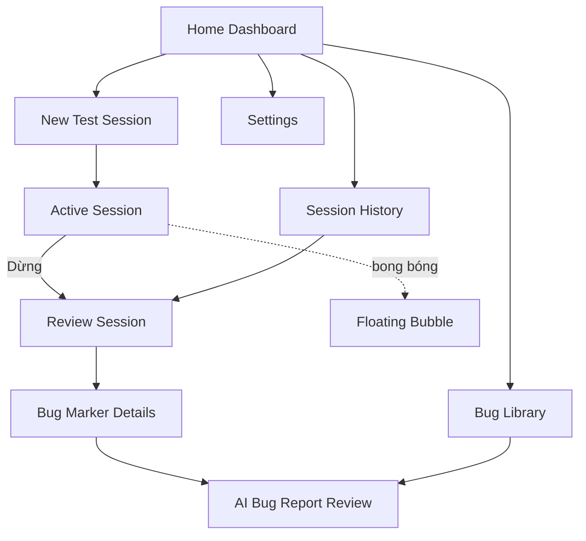

# 11 — Đặc tả UI/UX

## 1. Định hướng thị giác
Công cụ cho developer/QA, **dark-first**, palette navy/xanh đậm/cyan, chữ rõ, animation tối thiểu, thao tác một tay (hành động chính ở nửa dưới màn hình).
| Token | Giá trị đề xuất |
|---|---|
| `background` | `#0B1220` |
| `surface` | `#111B2E` |
| `surfaceVariant` | `#1A2740` |
| `primary` (cyan) | `#22D3EE` |
| `onPrimary` | `#04222A` |
| `danger` | `#F87171` |
| `warning` | `#FBBF24` |
| `success` | `#34D399` |
| `text` / `textMuted` | `#E6EDF7` / `#93A4BD` |
Chữ: Inter hoặc hệ thống (không tải font ngoài nếu không cần); `Roboto Mono` cho id/timestamp. Chạm tối thiểu 48 dp. Chiều tương phản đạt WCAG AA.

## 2. Điều hướng

Bottom navigation 3 mục: **Home**, **Sessions**, **Library**; Settings ở biểu tượng góc trên của Home.

## 3. Các màn hình
Quy ước trạng thái: **Empty / Loading / Error / Permission** có cho từng màn.

### 3.1 Home Dashboard
- Mục đích: bắt đầu nhanh, xem tình trạng.
- Thành phần: nút lớn **"Bắt đầu phiên mới"**, thẻ phiên gần nhất, số bug nháp chờ duyệt, thẻ trạng thái quyền (overlay, thông báo, pin).
- Hành động: bắt đầu phiên, mở bug nháp, sửa quyền.
- Empty: minh họa chữ + nút bắt đầu. Loading: skeleton. Error: banner có "Thử lại". Permission: thẻ cảnh báo kèm nút "Cấp quyền".

### 3.2 New Test Session
- Mục đích: cấu hình phiên.
- Thành phần: tên phiên, chọn AUT (danh sách app có launcher), build/version (tự điền từ PackageManager, sửa được), độ dài buffer (15/30 s, mặc định 30 s), post-roll, ghi chú bối cảnh/hành vi mong đợi (tùy chọn, dùng cho AI), công tắc "Hiện bong bóng".
- Hành động: **Bắt đầu** → luồng quyền → hộp thoại hệ thống MediaProjection → Active Session.
- Lỗi: AUT không chọn được ⇒ cho nhập tay tên. Permission: nếu thiếu overlay, hiện giải thích + chuyển sang chế độ dự phòng.

### 3.3 Active Session
- Mục đích: điều khiển và theo dõi khi quay (người dùng thường ở app khác nên màn này ít dùng).
- Thành phần: đồng hồ phiên, trạng thái (RECORDING/PAUSED + lý do), số marker, bộ đệm đã đầy %, dung lượng trống, nút **Mark Bug** lớn, Pause/Resume, Stop, danh sách marker gần đây (chạm để thêm ghi chú).
- Trạng thái: PAUSED(PROJECTION_LOST) hiện nút "Cấp lại quyền quay"; LOW_STORAGE hiện cảnh báo.
- Lỗi: encoder thất bại ⇒ màn FAILED với "Xem bằng chứng đã có".

### 3.4 Floating Bubble Controller
- Trạng thái: **Thu nhỏ** (chấm ~48 dp, alpha 0.6, bám cạnh) và **Mở rộng** (cột/ hàng 4 nút: Mark Bug, Note, Pause/Resume, Mở app; Stop cần nhấn giữ hoặc xác nhận).
- Hành vi: kéo thả; thả gần cạnh ⇒ bám; chạm ⇒ mở rộng, tự thu sau 3 s; **chạm một lần vào Mark Bug trong chế độ thu nhỏ** là cấu hình tùy chọn "Mark nhanh" (chạm đôi để mở rộng) — mặc định tắt để tránh chạm nhầm.
- Phản hồi Mark: xác nhận nhận thao tác, countdown phần ghi thêm, đang lưu, kết quả đã lưu hoặc lỗi theo `17_CAPTURE_FEEDBACK_UX.md`. Rung xác nhận ngắn tại bề mặt trực tiếp. Nút Xem clip mở đúng marker sau khi lưu hoàn tất.
- Không che AUT: kích thước nhỏ, vị trí nhớ theo hướng màn hình, tránh vùng gesture hệ thống, tự mờ.
- Overlay bị từ chối: thông báo có nút Mark Bug/Pause/Stop + Quick Settings tile "Mark Bug".
- Ẩn khi: phiên PAUSED do người dùng (hiện chấm vàng), phiên kết thúc.

### 3.5 Bug Marker Details
- Thành phần: trình phát clip, dải ảnh (Mark/Pre), timestamp, ghi chú (sửa được), trạng thái clip (READY/PENDING/FAILED/LOST), nút **Tạo report AI**, **Soạn tay**, Xóa marker.
- Empty: marker không có clip ⇒ giải thích lý do. Loading: đang xuất clip (tiến độ). Error: CLIP_FAILED ⇒ thử lại/bỏ qua.

### 3.5b Chọn bằng chứng gửi AI
Màn trung gian bắt buộc: lưới keyframe có checkbox, xem ghi chú sẽ gửi, danh sách metadata, dòng chi phí ước tính, nút **Gửi cho AI** / Hủy. Không gửi gì trước khi bấm.

### 3.6 AI Bug Report Review
- Thành phần: các trường report có chip nguồn (Quan sát / Ghi chú / Suy đoán / Chưa biết); trường `needs_confirmation` viền cảnh báo + nút "Xác nhận"/sửa; danh sách thiếu thông tin; gợi ý test case; ảnh bằng chứng; nút **Hoàn tất** (vô hiệu đến khi mọi trường cảnh báo xử lý), **Sao chép**, **Markdown**, **Chia sẻ**.
- Loading: đang chờ AI (hủy được). Error: banner với thử lại/soạn tay. Offline: "Đã xếp hàng, sẽ gửi khi có mạng".
- Không có nút "Gửi lên Jira" tự động ở MVP.

### 3.7 Session History
Danh sách phiên (tên, ngày, số marker, trạng thái). Lọc theo trạng thái/ngày. Hành động: mở, xóa (xác nhận, hiển thị dung lượng giải phóng). Empty: "Chưa có phiên nào".

### 3.8 Bug Library
Ô tìm kiếm, chip lọc (Nháp/Hoàn tất, severity, phiên, ngày), danh sách thẻ (tiêu đề, trạng thái, ảnh thu nhỏ). Hành động: mở/sửa/xóa/xuất. Empty/Loading/Error như trên.

### 3.9 Settings
Buffer (15/30 s, mặc định 30) & post-roll mặc định, chất lượng quay (Chuẩn/Tiết kiệm), tự xóa clip sau N ngày, URL backend + token, trần ngân sách AI, trạng thái quyền + hướng dẫn pin OxygenOS, "Mark nhanh", xóa toàn bộ dữ liệu, phiên bản/giấy phép.

## 4. Chỉ báo ghi hình
Notification liên tục (biểu tượng + chữ "Đang ghi phiên: <tên>"), chip hệ thống Android, bong bóng viền cyan khi ghi/vàng khi pause. Không có chế độ ghi "ẩn".

## 5. Trợ năng
Nhãn `contentDescription` cho bong bóng, hỗ trợ cỡ chữ lớn, không chỉ dùng màu để truyền trạng thái (kèm icon/chữ).

## 6. Hướng dẫn pin OxygenOS (nội dung màn onboarding)
Các bước (tên mục có thể khác theo bản OS, **cần xác minh trên Ace 5**): cho phép hoạt động nền không giới hạn, bật tự khởi chạy nếu có, khóa app trong màn hình đa nhiệm, tắt "tối ưu hóa pin" cho BugSnap AI. Nút mở đúng màn hình cài đặt khi có thể.

## 7. Thiết kế bổ sung cho phản hồi quay và Mark Bug

Đề xuất ngày 21/11/2026 chi tiết hóa các mốc nhận thao tác, ghi thêm, đang lưu, đã lưu và lỗi, cùng thiết kế overlay/notification/màn trong app. Xem [17 — Capture feedback UX](../../../17_CAPTURE_FEEDBACK_UX.md) và [bản phác thảo tương tác](../../../design/capture-feedback.html). Bản spike 0.1.1-t010 đã triển khai luồng phản hồi chính. Bằng chứng và phạm vi kiểm chứng nằm trong [nhật ký triển khai](../../../UI_UX_IMPLEMENTATION.md).
