# 14 — Lộ trình phát triển

## 0. Thay đổi so với thứ tự đề bài
Thêm **Phase 0 — Nền tảng + Spike kỹ thuật** trước Phase 1. Lý do: rủi ro lớn nhất (MediaProjection + MediaCodec ring buffer + overlay + OxygenOS) chưa được kiểm chứng trên Ace 5; làm UI trước khi chắc chắn là lãng phí. Ngoài ra **Bug Library cục bộ chuyển ra khỏi Phase 2 sớm hơn một phần**: lưu report (DRAFT/COMPLETED) cần có trước khi AI vì tester phải soạn tay được khi offline.

```mermaid
gantt
    dateFormat  X
    axisFormat  %s
    section Phase 0
    Scaffold + spike capture :p0, 0, 2
    section Phase 1
    Session + overlay + buffer + marker :p1, 2, 6
    section Phase 2
    Library + AI + export :p2, 8, 5
    section Phase 3
    Voice, annotation, Jira... :p3, 13, 6
```

(Đơn vị tương đối ≈ tuần cho một lập trình viên; không phải cam kết.)

## Phase 0 — Nền tảng và Spike
- **Scope:** project scaffold, theme, DI, DB nền; spike `T-010` kiểm chứng checklist `06` §9.
- **Phụ thuộc:** thiết bị Ace 5 có bật gỡ lỗi (chỉ dùng khi phát triển).
- **Sản phẩm:** app chạy được, báo cáo kết quả spike trong `16`.
- **Acceptance:** quay được, ring buffer ra clip phát được trên Ace 5; trả lời V1–V9.
- **Rủi ro:** projection/overlay hành xử khác dự đoán ⇒ điều chỉnh `06`/`07` trước Phase 1.
- **Kiểm thử:** thủ công + unit ring buffer.
- **DoD:** `16` cập nhật kết quả spike; quyết định tiếp tục/chỉnh phương án.

## Phase 1 — Core Recording MVP
- **Scope:** session manager + state machine, `CaptureService`, bong bóng + dự phòng thông báo/tile, ring buffer, Mark Bug, marker pipeline, lưu evidence, Session history/review.
- **Phụ thuộc:** Phase 0.
- **Sản phẩm:** tester chạy phiên 30 phút, mark nhiều bug, xem lại clip/ảnh.
- **Acceptance:** 50 marker liên tiếp trên Ace 5 thành công ≥ 99%; phục hồi sau kill; chỉ báo ghi đủ.
- **Rủi ro:** OxygenOS kill nền, RAM, xoay màn hình.
- **Kiểm thử:** unit (state, buffer, pipeline) + checklist `13` §4.
- **DoD:** AGENTS DoD chung + checklist Ace 5 đã chạy, kết quả ghi lại.

## Phase 2 — Library + AI + Export (MVP đầy đủ)
- **Scope:** Bug Library (Room+FTS), soạn tay, chọn keyframe, màn duyệt gửi AI, backend FastAPI, sinh report, màn review có nhãn nguồn, hàng đợi offline, xuất Markdown/clipboard/Share.
- **Phụ thuộc:** Phase 1, backend có khóa AI.
- **Acceptance:** từ marker → report đã duyệt → Markdown share trong ≤ 3 thao tác; không gửi gì trước khi duyệt; trần ngân sách hoạt động; chi phí/report đo được.
- **Rủi ro:** chất lượng AI, chi phí, model không có vision, prompt injection.
- **Kiểm thử:** unit schema/map lỗi, backend pytest, đánh giá 20 marker mẫu.
- **DoD:** DoD chung + báo cáo chi phí thực + đánh giá chất lượng ghi vào `16`.

## Phase 3 — Nâng cao (đánh giá từng mục, không bắt buộc)
| Mục | Ưu tiên | Phụ thuộc chính | Nhận xét |
|---|---|---|---|
| Redaction vùng ảnh | Cao | Màn ảnh | Giảm rủi ro riêng tư — nên làm đầu tiên |
| Chú thích ảnh | Cao | Màn ảnh | Giá trị cao với tester |
| Ghi chú giọng nói | Trung bình | `RECORD_AUDIO`, STT | Cần kiểm tiếng Việt |
| Xuất PDF | Trung bình | Library | `PdfDocument` của Android đủ dùng |
| So sánh before/after | Trung bình | AI vision | |
| Bug tương tự | Trung bình | FTS/embedding | |
| Jira REST | Trung bình | Báo cáo hoàn tất, auth | Tùy chọn; token Jira trong Keystore |
| AccessibilityService metadata | Thấp, **chỉ APK riêng, tắt mặc định** | Rủi ro riêng tư/Play | Chỉ làm khi có nhu cầu rõ và đồng ý của chủ dự án |
| MCP | Rất thấp | — | Chỉ khi cần agent truy vấn kho bug |
- **Rủi ro chung:** phình scope. Mỗi mục cần quyết định riêng, ghi ADR.
- **DoD:** như Phase 2 cho từng mục.
