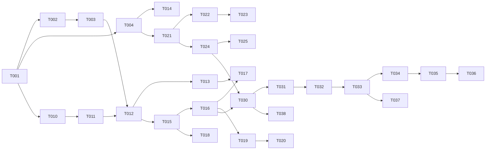

# 15 — Danh sách task triển khai

**Quy ước:** mỗi task nhỏ, độc lập, làm một lần. **DoD chung** (xem `AGENTS.md` mục D) áp dụng cho mọi task; mục "DoD" dưới đây chỉ ghi phần **bổ sung**. "Test" = yêu cầu kiểm thử tối thiểu. Đường dẫn trong `app/src/main/java/com/bugsnap/ai/`.

## Đồ thị phụ thuộc

---
## Phase 0
### T-001 Khởi tạo project
- **Mục tiêu:** project Android chạy được, theme, DI, điều hướng rỗng.
- **Tiên quyết:** không.
- **Triển khai:** Gradle Kotlin DSL, version catalog, Compose M3, Hilt, Navigation, `:app` một module, theme dark theo `11`.
- **File:** `build.gradle.kts`, `libs.versions.toml`, `BugSnapApp.kt`, `ui/theme/*`, `ui/navigation/*`.
- **Acceptance:** cài lên Ace 5, mở được màn Home rỗng; lint sạch.
- **Test:** unit mẫu chạy; build `assembleDebug`.
- **DoD+:** README ghi lệnh build.

### T-002 Core: Result, DomainError, Clock, Dispatchers
- **Mục tiêu:** nền chung. **Tiên quyết:** T-001.
- **Triển khai:** `DomainError` sealed, `Result` mở rộng, `Clock` trừu tượng, qualifier dispatcher.
- **File:** `core/common/*`. **Acceptance:** tất cả module sau dùng được.
- **Test:** unit ánh xạ lỗi. **DoD+:** không phụ thuộc Android ở `core/common` trừ khi cần.

### T-003 SessionStateMachine (thuần Kotlin)
- **Mục tiêu:** bảng chuyển trạng thái `05` §5. **Tiên quyết:** T-002.
- **Triển khai:** `SessionState`, `PauseReason`, `SessionEvent`, hàm `reduce(state,event)`.
- **File:** `session/SessionStateMachine.kt`, `session/SessionState.kt`.
- **Acceptance:** mọi chuyển hợp lệ pass; chuyển sai trả `IllegalTransition`, không ném crash.
- **Test:** unit tham số hóa toàn ma trận. **DoD+:** bảng chuyển khớp `05`.

### T-004 Room schema nền
- **Mục tiêu:** DB cho session/marker/evidence (chưa report). **Tiên quyết:** T-001.
- **Triển khai:** entity, DAO, `exportSchema`, ràng buộc/cascade theo `09`.
- **File:** `data/db/*`. **Acceptance:** CRUD đúng, cascade đúng.
- **Test:** instrumentation DAO + migration test khung. **DoD+:** schema JSON commit.

### T-010 ⭐ SPIKE: MediaProjection + MediaCodec ring buffer trên Ace 5
- **Mục tiêu:** kiểm chứng V1–V9 của `06` §9 bằng app thử tối giản.
- **Tiên quyết:** T-001.
- **Triển khai:** FGS mediaProjection, callback, VirtualDisplay → encoder, ring buffer tạm, nút "Mark" lưu clip qua MediaMuxer, đo RAM/độ trễ. Mã spike nằm trong nhánh riêng, **có thể bỏ**.
- **File:** nhánh `spike/capture`, ghi kết quả vào `docs/16` mục B.
- **Acceptance:** clip phát được trên máy; điền đủ V1–V9; có quyết định tiếp tục/chỉnh `06`/`07`.
- **Test:** thủ công trên Ace 5, ghi build/OS. **DoD+:** `16` cập nhật; không merge mã spike vào chính nếu chưa tái cấu trúc.

---
## Phase 1
### T-011 EncodedSample + RingBuffer
- **Trạng thái:** hoàn thành triển khai/kiểm thử JVM ngày 2026-11-21: 100 unit test pass (28 test buffer/export), build/lint 0 lỗi; 1 lượt quay hồi quy trên emulator pass. [Bằng chứng T-011](../../../T011_ROLLING_BUFFER.md). Checklist V1–V9 của T-010 trên Ace 5 vẫn chưa nghiệm thu, không được tính đã đạt từ kết quả này.
- **Mục tiêu:** ring buffer thuần JVM theo `07`. **Tiên quyết:** T-010.
- **Triển khai:** cắt tỉa theo GOP, snapshot bất biến, generation, khóa an toàn luồng.
- **File:** `capture/buffer/*`. **Acceptance:** mọi test §10 của `07` pass.
- **Test:** unit mạnh (mẫu giả, ngẫu nhiên hóa). **DoD+:** không phụ thuộc Android.

### T-012 CaptureEngine (VirtualDisplay + encoder)
- **Mục tiêu:** quay và đẩy mẫu vào buffer. **Tiên quyết:** T-011, T-003.
- **Triển khai:** `ProjectionHolder`, `VirtualDisplayController`, `EncoderPipeline`, theo dõi xoay/resize, nhiệt, release trong `finally`.
- **File:** `capture/engine/*`. **Acceptance:** chạy 10 phút không rò rỉ; xoay 20 lần ổn định.
- **Test:** instrumentation/thủ công + unit cho phần logic cấu hình. **DoD+:** checklist rò rỉ tài nguyên.

### T-013 ClipMuxer + FrameExtractor
- **Mục tiêu:** snapshot → MP4 + 2 ảnh. **Tiên quyết:** T-011.
- **Triển khai:** mux `.part`→rename, kiểm duration, `MediaMetadataRetriever` ảnh Mark/Pre.
- **File:** `capture/export/*`. **Acceptance:** clip phát được, bắt đầu ở keyframe.
- **Test:** unit với mẫu giả + instrumentation mux thật. **DoD+:** dọn `.part` mồ côi.

### T-014 EvidenceStore
- **Trạng thái:** hoàn thành 2026-11-21. Build/lint pass (0 error), 82 unit test và 24 instrumentation pass (19 test T-014 + 5 test Room). [Triển khai và bằng chứng](../../../T014_EVIDENCE_STORE.md). Sau T-014, video mới của spike chuyển sang DCIM/BugSnap theo ADR-21; ảnh/index vẫn riêng. Nối pipeline phiên thuộc T-015/T-016.
- **Mục tiêu:** quản lý file theo bố cục `09` §6. **Tiên quyết:** T-004.
- **Triển khai:** đường dẫn tương đối, ghi atomic, xóa phiên, kiểm dung lượng.
- **File:** `data/files/EvidenceStore.kt`. **Acceptance:** xóa phiên xóa hết file; không đường dẫn tuyệt đối trong DB.
- **Test:** instrumentation với thư mục tạm.

### T-015 SessionCoordinator
- **Mục tiêu:** nguồn sự thật trạng thái phiên. **Tiên quyết:** T-003, T-004, T-012.
- **Triển khai:** StateFlow, lệnh start/pause/resume/stop/mark, ghi trạng thái xuống DB, phục hồi khi khởi động (`PROCESS_DIED`).
- **File:** `session/SessionCoordinator.kt`. **Acceptance:** sau kill giả lập, phiên thành FAILED và marker PENDING → CLIP_LOST.
- **Test:** unit với engine giả.

### T-016 MarkerPipeline
- **Mục tiêu:** Mark → clip + ảnh + DB, hỗ trợ marker liên tiếp. **Tiên quyết:** T-013, T-014, T-015.
- **Triển khai:** insert PENDING, snapshot, post-roll, hàng đợi `Semaphore(3)`, retry 1 lần, cập nhật trạng thái.
- **File:** `session/MarkerPipeline.kt`. **Acceptance:** 10 marker/3 s không ghi đè; marker lỗi không làm hỏng marker khác.
- **Test:** unit fake muxer; thủ công 50 marker.

### T-017 CaptureService + notification
- **Mục tiêu:** FGS đúng chuẩn. **Tiên quyết:** T-013, T-016.
- **Triển khai:** type mediaProjection, quyền, `START_NOT_STICKY`, notification có nút Mark/Pause/Stop, xử lý `onStop` callback, flush khi hủy.
- **File:** `session/CaptureService.kt`, `core/notification/*`, manifest. **Acceptance:** nút thông báo hoạt động khi không có overlay.
- **Test:** instrumentation + thủ công.

### T-018 PermissionCoordinator + onboarding
- **Mục tiêu:** gom trạng thái quyền, màn hướng dẫn. **Tiên quyết:** T-015.
- **Triển khai:** thông báo, overlay, hướng dẫn pin OxygenOS, StateFlow quyền.
- **File:** `core/permission/*`, `ui/home/*`. **Acceptance:** từ chối overlay ⇒ chế độ dự phòng, không crash.
- **Test:** Compose test trạng thái quyền.

### T-019 BubbleController
- **Mục tiêu:** bong bóng nổi. **Tiên quyết:** T-016.
- **Triển khai:** `TYPE_APPLICATION_OVERLAY`, kéo thả/bám cạnh, thu/mở, tự mờ, Mark Bug, rung, lưu vị trí theo hướng màn hình.
- **File:** `overlay/*`. **Acceptance:** không chặn gesture cạnh; chạm AUT bình thường ngoài vùng bong bóng.
- **Test:** thủ công trên Ace 5 + unit cho logic vị trí.

### T-020 Quick Settings Tile "Mark Bug"
- **Mục tiêu:** đường dự phòng thứ hai. **Tiên quyết:** T-019.
- **File:** `overlay/QuickActionTile.kt`. **Acceptance:** tile bật/tắt theo trạng thái phiên.
- **Test:** thủ công.

### T-021 Màn: Home, New Session, Active Session
- **Mục tiêu:** UI phiên theo `11` §3.1–3.3. **Tiên quyết:** T-015, T-018.
- **File:** `ui/home|newsession|activesession/*`. **Acceptance:** đủ trạng thái Empty/Loading/Error/Permission; tạo và dừng phiên.
- **Test:** Compose test.

### T-022 Màn: Session History + Review + Marker Details
- **Mục tiêu:** xem lại bằng chứng. **Tiên quyết:** T-021, T-016.
- **File:** `ui/history|marker/*`. **Acceptance:** phát clip, xem ảnh, sửa ghi chú, xóa phiên có xác nhận.
- **Test:** Compose test + thủ công.

### T-023 Settings (MVP phần ghi hình)
- **Mục tiêu:** buffer (15/30 s, mặc định 30)/post-roll/retention/chất lượng. **Tiên quyết:** T-021.
- **File:** `data/settings/*`, `ui/settings/*`. **Acceptance:** cài đặt áp dụng cho phiên mới.
- **Test:** unit DataStore.

---
## Phase 2
### T-024 Report schema + ReportRepository + FTS
- **Mục tiêu:** lưu report, tìm kiếm. **Tiên quyết:** T-004.
- **File:** `data/db/report*`, `domain/*`. **Acceptance:** tìm theo tiêu đề/mô tả/bước; lọc theo trạng thái.
- **Test:** instrumentation + migration.

### T-025 Màn: Bug Library + soạn tay
- **Tiên quyết:** T-024, T-022. **File:** `ui/library/*`, `ui/reportreview/*` (chế độ soạn tay).
- **Acceptance:** tạo/sửa/xóa report DRAFT; xem bằng chứng. **Test:** Compose test.

### T-030 Keyframe selector + nén ảnh
- **Mục tiêu:** chọn ≤6 ảnh `08` §3. **Tiên quyết:** T-016, T-024.
- **File:** `data/files/KeyframeSelector.kt`. **Acceptance:** ảnh cạnh dài 768 px, q75; loại ảnh trùng.
- **Test:** unit với ảnh mẫu.

### T-031 Màn "Chọn bằng chứng gửi AI"
- **Tiên quyết:** T-030. **File:** `ui/reportreview/ApprovePayloadScreen.kt`.
- **Acceptance:** không có request mạng trước nút Gửi; hiển thị chính xác thứ sẽ gửi.
- **Test:** Compose + test chặn (fake client xác nhận chưa gọi).

### T-032 Backend FastAPI
- **Mục tiêu:** `/v1/health`, `/v1/reports:generate`, `/v1/usage`. **Tiên quyết:** không (song song được).
- **File:** `backend/app/**`. **Acceptance:** schema, budget guard, text-only mode, mã lỗi `10` §3.
- **Test:** pytest với provider giả; không gọi API thật.

### T-033 AiReportClient (Android)
- **Tiên quyết:** T-031, T-032. **File:** `data/remote/*`.
- **Triển khai:** multipart, timeout, map lỗi → `DomainError`, validate lại JSON.
- **Acceptance:** lỗi 401/429/504/schema được xử lý đúng. **Test:** unit với MockWebServer.

### T-034 Hàng đợi offline (WorkManager)
- **Tiên quyết:** T-033. **File:** `data/remote/AiQueueWorker.kt`.
- **Acceptance:** chỉ gửi yêu cầu đã duyệt; gửi lại khi có mạng; không retry vô hạn.
- **Test:** instrumentation với WorkManager test.

### T-035 AI Bug Report Review
- **Tiên quyết:** T-034, T-025. **File:** `ui/reportreview/*`.
- **Triển khai:** chip nguồn, trường cần xác nhận, Hoàn tất chỉ khi xử lý hết.
- **Acceptance:** không thể COMPLETED khi còn `needsConfirmation`. **Test:** Compose + unit.

### T-036 Hiệu chỉnh chi phí/chất lượng
- **Tiên quyết:** T-035. **Mục tiêu:** chạy 10–20 marker mẫu, ghi chi phí/report và chất lượng vào `16`.
- **Acceptance:** số liệu thật được ghi; điều chỉnh số ảnh/prompt nếu vượt ngân sách.

### T-037 Export: clipboard, Markdown, Share Sheet
- **Tiên quyết:** T-025. **File:** `domain/usecase/Export*`, `FileProvider` cấu hình.
- **Acceptance:** Markdown đúng mẫu; share kèm ảnh/clip qua `content://`.
- **Test:** unit định dạng Markdown + instrumentation share intent.

### T-038 Dọn dẹp & retention
- **Tiên quyết:** T-014. **Mục tiêu:** tự xóa clip quá hạn, dọn `exports/`, `.part`.
- **Acceptance:** chạy khi khởi động và theo cài đặt. **Test:** unit với Clock giả.

---
## Phase 3 (mỗi mục là task riêng, chỉ làm sau khi chủ dự án duyệt)
- **T-050** Redaction vùng ảnh (blur/hộp đen). **T-051** Chú thích ảnh. **T-052** Ghi chú giọng nói + STT. **T-053** Xuất PDF. **T-054** So sánh before/after. **T-055** Bug tương tự. **T-056** Jira REST. **T-057** (tùy chọn) AccessibilityService metadata, tắt mặc định, chỉ APK riêng.
Mỗi mục cần: đặc tả riêng trong `docs/`, ADR, và acceptance/test như trên.

## Thứ tự gợi ý để agent
T-001 → T-002/T-003/T-004 → **T-010** → T-011 → T-012/T-013/T-014 → T-015 → T-016 → T-017 → T-018 → T-019/T-020 → T-021 → T-022/T-023 → (Phase 2) T-024 → T-025/T-030 → T-031 → T-032 → T-033 → T-034 → T-035 → T-036 → T-037/T-038.
